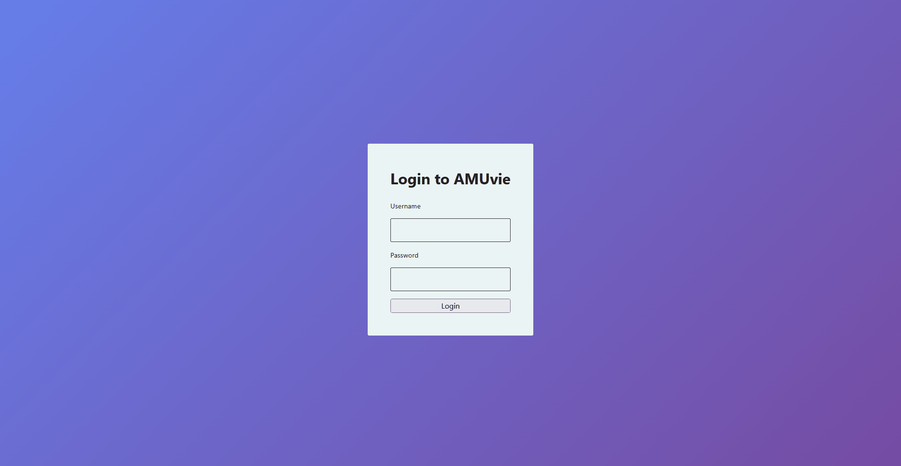
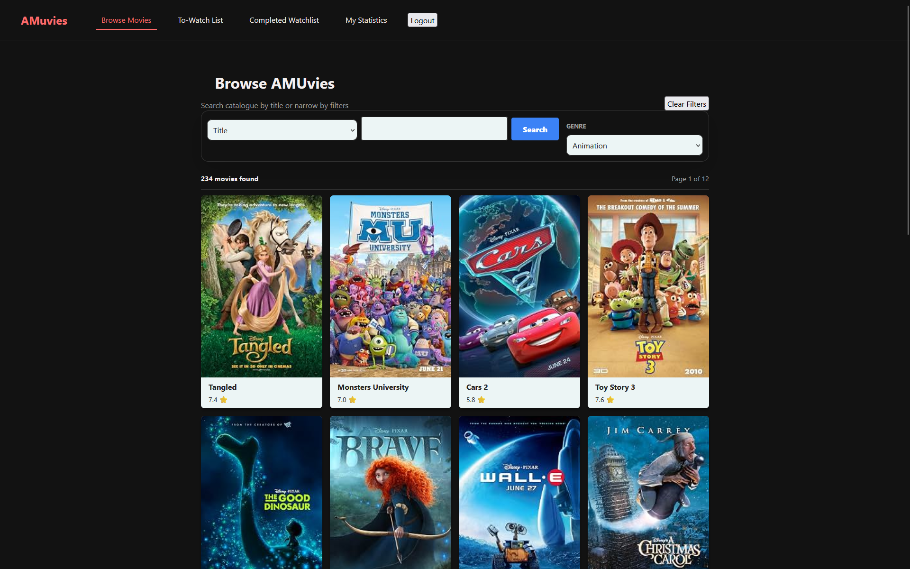
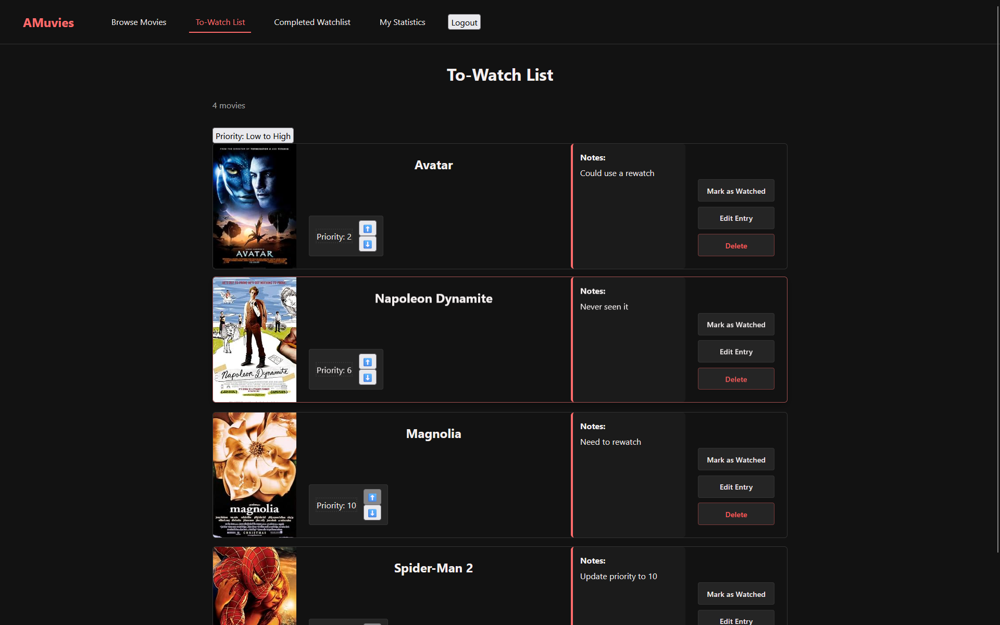
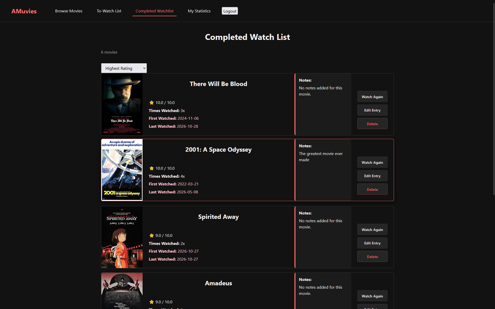

# AMUvie

A full-stack movie tracker application. Browse the catalogue, keep a to-watch list and log what you've watched in your completed watchlist.



## Screenshots




## Features

- Public movie catalogue
- Movie search and genre filtering
- Detailed movie pages
- User authentication
- Prioritized to-watch list
- Completed viewing history
- Movie ratings and watch counts
- Personal viewing statistics
- Responsive error and status feedback

## Technology

### Frontend

- React
- TypeScript
- React Router
- Vite
- Fetch API

### Backend

- PHP
- MySQL
- PDO
- REST-style JSON API
- API-key authentication

## Project structure

```text
backend/
  api/              PHP API endpoints
  database/         Database schema
  includes/         Shared backend utilities
public/             Static frontend assets
src/                React application source
```